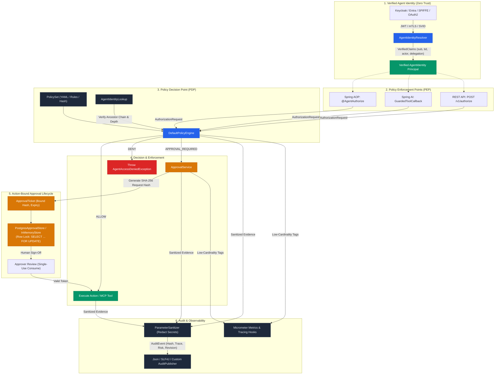

# AgentGuard

**Tool-level authorization, request-bound approvals, and sanitized audit trails for AI agents.**

> **AgentGuard provides deterministic authorization and governance for AI agent actions and complements OAuth/JWT/Spring Security rather than replacing authentication.**

[](https://central.sonatype.com/artifact/io.github.amaljeevs/agentguard-parent)
[](https://github.com/Amaljeevs/agentguard/releases)
[](https://github.com/Amaljeevs/agentguard/actions/workflows/ci.yml)
[](https://github.com/Amaljeevs/agentguard/actions/workflows/codeql.yml)
[](https://javadoc.io/doc/io.github.amaljeevs/agentguard-parent)
[](https://openjdk.org/projects/jdk/21/)
[](LICENSE)

**Current release: 0.2.1**

See [CHANGELOG.md](CHANGELOG.md) for behavior changes and migration.

---

### Understand AgentGuard in 30 Seconds

1. **Who calls?** Upstream authentication (OAuth2 / OIDC / mTLS / SPIFFE / Spring Security) validates credentials and supplies trusted claims.
2. **What is proposed?** An AI agent, LLM tool, or MCP client requests an action (e.g., `kubernetes.deploy` or `database.query`) with specific arguments.
3. **Who decides?** AgentGuard evaluates the request against deterministic, declarative policies without letting the LLM decide its own safety.
4. **What happens?**
   - **`ALLOW`**: The tool executes immediately.
   - **`DENY`**: Execution halts fail-closed with clear decision reason, matched policy, and risk metadata.
   - **`APPROVAL_REQUIRED`**: Generates a cryptographic SHA-256 request binding (`ApprovalTicket`) requiring human sign-off before single-use execution.
5. **What is recorded?** Parameter-sanitized audit trails record argument hashes, delegation chains, policy revisions, and trace IDs without leaking secrets.

---

### When should I use AgentGuard?

Use AgentGuard when:
- **You build autonomous AI agents or tool-calling systems** that interact with production APIs, databases, cloud infrastructure, or financial transactions.
- **You need deterministic security invariants**: RBAC permissions and safety rules must be enforced by application code, never by prompt engineering or LLM self-policing.
- **You need action-bound human approvals**: Critical actions must be cryptographically bound to exact canonical arguments, policy versions, and expiration timestamps, preventing argument tampering or replay attacks.
- **You have agent delegation hierarchies**: Child agents execute tasks on behalf of parent agents, requiring strict containment (`child permissions ⊆ parent permissions`), cycle detection, and max depth limits.
- **You need compliance & forensic audit trails**: Every decision must be traceable with policy versions and correlation IDs, while sensitive data (tokens, passwords, PII) is automatically redacted.
- **You need polyglot or MCP support**: Intercept Spring AI tools, MCP protocol servers, Spring AOP services, or non-Java agents via `POST /v1/authorize`.

---

## Quickstart: Integrate AgentGuard

### 1. Maven Dependencies

AgentGuard is modular. For a standard Spring Boot 3 application, you only need **`agentguard-spring-boot-starter`**:

```xml
<dependency>
    <groupId>io.github.amaljeevs</groupId>
    <artifactId>agentguard-spring-boot-starter</artifactId>
    <version>0.2.1</version>
</dependency>
```

> [!NOTE]
> `agentguard-spring-boot-starter` automatically brings in the core engine (`agentguard-core`), policy loader (`agentguard-policy`), audit sanitizer (`agentguard-audit`), and `@AgentAuthorize` annotations (`agentguard-spring`).
>
> **Do not add `agentguard-parent` directly as a `<dependency>`**; it has `<packaging>pom</packaging>` and produces no JAR file. If you wish to manage versions centrally, import `agentguard-parent` inside `<dependencyManagement>` as a BOM (Bill of Materials):
> ```xml
> <dependencyManagement>
>     <dependencies>
>         <dependency>
>             <groupId>io.github.amaljeevs</groupId>
>             <artifactId>agentguard-parent</artifactId>
>             <version>0.2.1</version>
>             <type>pom</type>
>             <scope>import</scope>
>         </dependency>
>     </dependencies>
> </dependencyManagement>
> ```

#### Optional Feature Modules
Add only the components your application requires:

| Feature | Dependency | What it provides |
| :--- | :--- | :--- |
| **Human Approvals** | `agentguard-approval` | `ApprovalService`, tickets, SHA-256 argument binding, `PostgresApprovalStore` |
| **Spring AI & MCP Tools** | `agentguard-spring-ai` | `GuardedToolCallback` wrapper for pre-execution Model Context Protocol enforcement |
| **Polyglot REST API** | `agentguard-spring-web` | Auto-configured `POST /v1/authorize` controller for non-Java clients (Python, Node.js) |

---

### 2. Configure Declarative Policy

Create `src/main/resources/agentguard-policy.yaml`:

```yaml
version: "1.0"
metadata:
  name: fintech-payments-governance
  version: "2026-10"

roles:
  payment-agent:
    permissions:
      - payments.transfer
      - payments.read

rules:
  - id: production-high-value-transfer-review
    effect: APPROVAL_REQUIRED
    risk: HIGH
    target:
      actions:
        - payments.transfer
      conditions:
        environment:
          equals: production
```

---

### 3. Protect Methods with `@AgentAuthorize`

Configure authentication through Spring Security or supply a trusted `AgentIdentityResolver`. Never accept identity or roles directly from untrusted model arguments.

```java
@Service
public class TreasuryTransferService {

    @AgentAuthorize(
        action = "payments.transfer",
        resourceType = "account",
        resource = "#fromAccount",
        environment = "production"
    )
    public PaymentReceipt transferFunds(String fromAccount, String toAccount, BigDecimal amount) {
        // Core banking ledger operation, executed only after AgentGuard authorizes it.
        return ledger.executeTransfer(fromAccount, toAccount, amount);
    }
}
```

A matching production approval rule blocks the method by throwing `AgentApprovalRequiredException`. Use the optional `agentguard-approval` module for ticket creation, approver checks, and cryptographic argument binding. Calls must go through the Spring proxy; self-invocation is not intercepted. Use `GuardedToolCallback` for Spring AI and MCP tools.

---

### 4. Configuration Properties

```yaml
agentguard:
  policy-location: classpath:agentguard-policy.yaml
  audit:
    enabled: true
    mask-token: "[REDACTED]"
    sensitive-keys: [routingNumber, accountSecret, iban, taxId, clientSecret]
    failure-mode: FAIL_CLOSED
```

The default JSON audit logger is `io.agentguard.audit.json`. It records a SHA-256 arguments fingerprint, delegation chain, policy version/hash, risk and trace ID; it never emits raw arguments. Authorization and execution outcomes are separate, correlated events. `BEST_EFFORT` is available when continuing after an audit sink failure is an explicit application decision. Post-execution logging failure may occur after side effects; applications still need idempotency.

## Modules

| Module | Responsibility |
| --- | --- |
| `agentguard-core` | Pure Java 21 policy engine, identity/request models, permission matching, content revisions, trusted delegation lookup, and metrics/tracing SPI |
| `agentguard-policy` | YAML loading/validation and declarative policy test CLI |
| `agentguard-audit` | Structured sanitization, `@Sensitive`, JSON/SLF4J/composite publishers, execution lifecycle |
| `agentguard-spring` | `@AgentAuthorize`, fail-closed expression resolution, Spring Security identity bridge, Micrometer metrics |
| `agentguard-spring-boot-starter` | Production auto-configuration, configuration properties, metrics/tracing beans |
| `agentguard-mcp` | Authorization-exception to MCP error-object mapping; no implicit transport registration |
| `agentguard-approval` | Exact-request approvals, cryptographic SHA-256 binding, expiration, atomic store SPI, `InMemoryApprovalStore`, and durable `PostgresApprovalStore` |
| `agentguard-spring-ai` | `GuardedToolCallback` and `ToolCallbackProvider` pre-execution enforcement wrappers |
| `agentguard-spring-web` | Language-neutral JSON `POST /v1/authorize` REST controller and auto-configuration |

The starter does not pull in an MCP server or an LLM provider.

## Policy semantics

Identity validity and explicit DENY rules are checked first. An explicit ALLOW or
role/direct permission must grant the action before a matching approval rule can
return APPROVAL_REQUIRED. Otherwise the result is DENY. For delegation, the
request must be eligible for both child and every trusted ancestor. The child's
complete effective permission set must also be a conservative subset of its
parent's authority. Unknown parents, inconsistent chains, privilege expansion,
cycles, excessive depth and invalid temporal bounds deny.

A configured expression that cannot resolve is denied; it does not silently
change the environment. Use trusted resource metadata for environments. The
core evaluator accepts an explicit evaluation timestamp for deterministic tests;
production callers must supply a trusted current clock.

See the [policy specification](specification/docs/POLICY_SPECIFICATION.md) and
[security boundaries](SECURITY.md).

## Architecture and trust flow



```text
OAuth/OIDC, mTLS or SPIFFE verifier
                |
                v
       AgentIdentityResolver  ---- trusted sub/client_id/actor/tenant/scopes
                |
                v
  AuthorizationRequest (identity + action + resource + canonical arguments + context)
                |
                v
     PolicyEngine  ---- DENY / ALLOW / APPROVAL_REQUIRED + policy/risk/trace evidence
          |                                  |
          |                                  v
          |                         ApprovalService (bound SHA-256,
          |                         expiry, atomic single use)
          v                                  |
  guarded method/tool execution <------------+
                |
                v
       sanitized audit evidence
```

`AgentIdentityResolver` is the trust boundary. The built-in JWT claim mapper only
accepts `VerifiedClaims`, which an upstream Keycloak, Entra, Spring Security,
SPIFFE-JWT or custom verifier must produce after validating signature, issuer,
audience and token lifetime. It maps `sub`, `client_id`, `azp`/`appid`, `oid`, `actor`,
`tenant`/`tid`, `scope`/`scp`, Keycloak realm/resource roles (`realm_access`, `resource_access`),
and `delegation_chain`. Dedicated `SpiffeAgentIdentityResolver` resolves workload SVIDs
(`spiffe://<trust-domain>/<workload>`) directly into isolated tenant and agent identities.
Request JSON and model tool arguments never supply effective agent IDs, roles or permissions.

For plain Java use, no server is required:

```java
AgentGuard agentGuard = new AgentGuard(policyEngine, trustedIdentityResolver);
AuthorizationDecision decision = agentGuard.authorize(request);
```

The resolver-backed facade replaces any identity carried by `request` with the
current verified identity. The one-argument constructor remains available for
trusted in-process requests that were already constructed from verified data.

The optional `agentguard-spring-web` module exposes the same engine to other
languages. Applications register `AgentGuardAuthorizationApi` and
`AuthorizationController` with their trusted identity resolver. `principal` is
only checked against that resolved identity; it never grants authority.

```http
POST /v1/authorize
Content-Type: application/json

{
  "principal": "deploy-agent",
  "action": "kubernetes.deploy",
  "resource": {"type": "cluster", "id": "prod-a", "tags": {}},
  "arguments": {"image": "orders:v2"},
  "context": {"environment": "production", "traceId": "trace-123"}
}
```

```json
{
  "decision": "APPROVAL_REQUIRED",
  "reason": "Production deployment requires review",
  "matchedPolicy": "cluster-governance",
  "matchedRule": "prod-deploy-review",
  "policyVersion": "2026-10",
  "policyHash": "...",
  "risk": "CRITICAL",
  "approvalRequestId": "...",
  "traceId": "trace-123"
}
```

Spring AI callbacks can route approval-required calls directly into the approval
module by using the `GuardedToolCallback` constructor that accepts an
`ApprovalService` and TTL. The real callback stays blocked; its exception carries
the bound approval request ID. MCP remains a small error adapter and is absent
from the core engine.

## Architecture Examples & Showcases

Ready-to-run examples demonstrating AgentGuard patterns across enterprise domains:

* **[Enterprise Fintech & Banking MCP Server](agentguard-examples/fintech-banking-mcp-server/README.md)**:
  Full-featured Model Context Protocol (MCP) server and multi-channel agent gateway showcasing high-stakes financial operations:
  - **Dedicated `tool` Package**: Clean domain connectors in `io.agentguard.fintech.tool` mapped deterministically to AgentGuard requests.
  - **Multi-Channel Agent Connectivity**: Serves both MCP-native agents (Claude Desktop, Cursor via `/mcp`) and external REST agents/chatbots (Slack, Teams, webhooks via `/api/agent/channel/invoke`) through the exact same governance rules.
  - **Payments & Wire Transfers**: Domestic & cross-border transfers with amount threshold governance. Canonical SHA-256 argument hashing strictly defeats LLM prompt injection and parameter tampering (e.g., silently altering payout amounts).
  - **B2B Corporate Disbursements**: Batch payroll and vendor payouts with cryptographic delegation chains (`CFO -> Payroll Bot`) and dual executive signoff.
  - **Escrow Contracts & Dispute Freeze**: Milestone-based fund releases with fail-closed state invariants that block automated releases when contracts are flagged as disputed.
  - **API Management via LLMs**: Prevents prompt injection from generating unauthorized wildcard or admin scopes (`*`), requiring security review for production credentials.
  - **Virtual Accounts & KYC Tiers**: Tier-based issuance limits (automated for Tier 1; human compliance review for high-volume Tier 3).
* **[Spring AI MCP Server](agentguard-examples/spring-ai-mcp-server/README.md)**: Real streamable HTTP MCP server integrating Spring AI tools with AgentGuard authorization, audit redaction, and approval lifecycle.
* **[Python Cross-Language Client](agentguard-examples/cross-language-client/README.md)**: Minimal non-Java client consuming `POST /v1/authorize` with upstream identity injection.

## Durable Approval Store (PostgreSQL)

For clustered environments, `agentguard-approval` provides `PostgresApprovalStore`, a production-grade durable reference implementation backed by standard JDBC `DataSource`.

### Features
- **Atomic Single-Use**: Executes `SELECT ... FOR UPDATE` row-level locking during ticket transitions (`APPROVED -> CONSUMED`), preventing race conditions, concurrent consumption, or replay attacks.
- **Index-Optimized Schema**: Includes indices on `subject_id`, `state`, and `expires_at` for high-throughput querying.
- **Schema DDL**: Pre-built migration script available at `schema-postgresql.sql`.

```java
@Bean
public ApprovalStore approvalStore(DataSource dataSource) {
    return new PostgresApprovalStore(dataSource);
}
```

```sql
-- DDL schema in agentguard-approval/src/main/resources/schema-postgresql.sql
CREATE TABLE IF NOT EXISTS agentguard_approvals (
    id VARCHAR(64) PRIMARY KEY,
    subject_id VARCHAR(128) NOT NULL,
    action_name VARCHAR(128) NOT NULL,
    resource_type VARCHAR(64) NOT NULL,
    resource_id VARCHAR(128) NOT NULL,
    request_hash VARCHAR(128) NOT NULL,
    arguments_hash VARCHAR(128) NOT NULL,
    policy_revision VARCHAR(128) NOT NULL,
    environment VARCHAR(64) NOT NULL,
    trace_id VARCHAR(128) NOT NULL,
    created_at TIMESTAMP WITH TIME ZONE NOT NULL,
    expires_at TIMESTAMP WITH TIME ZONE NOT NULL,
    state VARCHAR(32) NOT NULL,
    decided_by VARCHAR(128)
);
```

## Observability

AgentGuard provides first-class metrics and distributed tracing integration while enforcing strict privacy invariants:

### Strict Privacy Guarantee
- **Zero Secret or PII Leakage**: Metric tags never contain agent IDs, raw resources, tool arguments, or tokens.
- **Low-Cardinality Tags Only**: Tag dimensions are restricted to bounded enums:
  - `decision`: `ALLOW`, `DENY`, `APPROVAL_REQUIRED`
  - `risk`: `LOW`, `MEDIUM`, `HIGH`, `CRITICAL`
  - `event`: `created`, `approved`, `denied`, `expired`, `consumed`
  - `error_type`: `access_denied`, `missing_identity`, `principal_mismatch`, `invalid_environment`, `execution_failure`

### Micrometer Metrics
When `micrometer-core` is on the classpath and a `MeterRegistry` bean is available, `MicrometerAgentGuardMetrics` automatically records:
- `agentguard.decisions` (Counter): Total authorization decisions categorized by `decision` and `risk`.
- `agentguard.decision.duration` (Timer): Latency of policy evaluation routines.
- `agentguard.approval.events` (Counter): Total approval lifecycle state changes.
- `agentguard.errors` (Counter): Guard enforcement and evaluation failures.

### OpenTelemetry Tracing
Implement `AgentGuardTracingHook` to link AgentGuard audit trails and decision events directly to your distributed trace context:

```java
@Bean
public AgentGuardTracingHook otelTracingHook() {
    return () -> Optional.ofNullable(io.opentelemetry.api.trace.Span.current().getSpanContext().getTraceId());
}
```

Trace IDs are captured in `AuthorizationDecision.traceId()`, `ApprovalTicket.traceId()`, and all structured `AuditEvent` records.

## Threat model

AgentGuard is designed to stop forged payload identities, default-allow gaps,
delegation privilege expansion, altered or replayed approvals, unreviewed tool
execution and secret exposure through its standard audit publisher. It assumes
the application protects policy files, uses a real token/workload-identity
verifier, resolves resource facts such as production environment from trusted
data, registers only guarded callbacks, and implements atomic approval storage
for clustered deployments.

It does not validate credentials itself, sandbox arbitrary code, detect prompt
injection, make remote side effects exactly once, or sanitize logs outside the
AgentGuard audit pipeline. OAuth/JWT proves who presented a valid credential;
AgentGuard decides whether that verified identity may perform this exact action
on this resource now, and records the decision evidence.

## Tests, policy checks, and benchmarks

```shell
mvn clean verify
mvn -f agentguard-policy/pom.xml org.codehaus.mojo:exec-maven-plugin:3.5.0:java "-Dexec.mainClass=io.agentguard.policy.testing.PolicyTestCli" "-Dexec.args=agentguard-examples/spring-ai-mcp-server/src/main/resources/agentguard-policy.yaml specification/examples/policy-scenarios.json"
```

Run the CLI from the repository root after `mvn install`. It prints decisions,
matched rules, and policy revision; mismatched expectations return a failing
process status. CI also builds both independent published-release examples and
runs the Spring AI MCP network tests.

[The JMH harness](benchmarks/README.md) measures evaluation and sanitization for
specified workloads. Report hardware, JDK and workload with results; microbenchmarks
are not end-to-end latency guarantees.

| Integration | Tested baseline |
| --- | --- |
| Core, audit, policy, approvals | Java 21 |
| Spring starter and published consumer examples | Spring Boot 3.3.4 |
| New Spring AI/MCP example | Spring Boot 3.5.7, Spring AI 1.1.0, MCP Java SDK 0.16.0 |

Other versions are not claimed compatible until tested. Current audit/approval
changes are documented breaking behavior changes for consumers of 0.1.0.

## Boundaries and future work

Structured redaction does not detect every secret in arbitrary text or sanitize
all third-party logs. The in-memory approval store is not shared across processes
(use `PostgresApprovalStore` for durable clustered deployments). There
is no built-in risk scoring, universal prompt-injection protection, agent sandbox,
or Python/TypeScript/Go runtime. See [why-agentguard.md](why-agentguard.md) for
implemented capabilities and explicitly future work.

## Maintainer and security reports

Maintained by **Amal jeev s** ([@Amaljeevs](https://github.com/Amaljeevs)).
Contact [amaljeevs3739@gmail.com](mailto:amaljeevs3739@gmail.com).
Report vulnerabilities privately using [SECURITY.md](SECURITY.md).

## Publishing

The group ID is `io.github.amaljeevs`. Publishing is a maintainer release action:
select an unused non-SNAPSHOT release version, run all checks, configure Central
credentials/signing, then use `./mvnw clean deploy -P release` (Windows:
`./mvnw.cmd clean deploy -P release`). Version `0.2.1` is published on Maven Central;
subsequent releases must use an incremented version.

To publish through GitHub Actions, run **Publish to Maven Central** on the updated
`main` branch, or publish a release whose tag points to the release-version commit.
Re-running an older failed workflow uses its original commit, which may still
contain a SNAPSHOT version. The workflow intentionally rejects those versions.

Set the `GPG_PRIVATE_KEY` Actions secret to the complete ASCII-armored private
key export, including its BEGIN/END lines. The import step accepts actual line
breaks or literal `\n` sequences and rejects malformed keys without logging
their contents. Never paste private keys into issues or build logs.

CI and publishing use the Maven wrapper pinned to 3.9.9. Use the wrapper for
releases: Maven 3.10 can leave `maven-metadata-local.xml` in the publishing
plugin's staging directory, producing Central's misleading missing-POM error.
A failed publish preserves the bundle as a workflow artifact for inspection.

## License

[Apache License 2.0](LICENSE). Copyright (c) 2026 Amal Jeev S.
