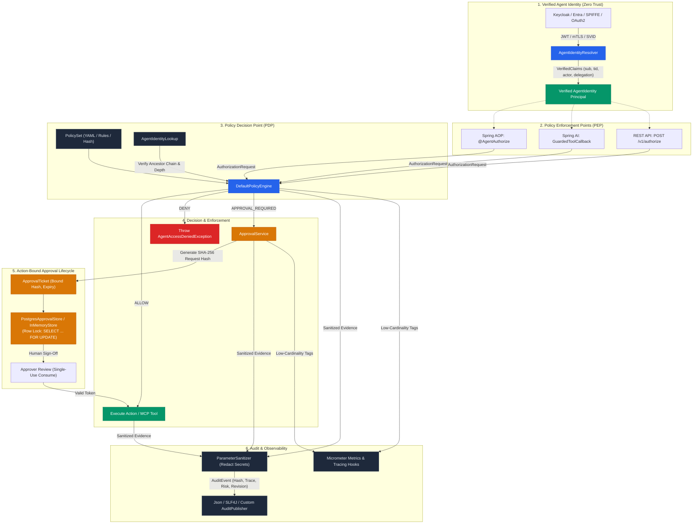
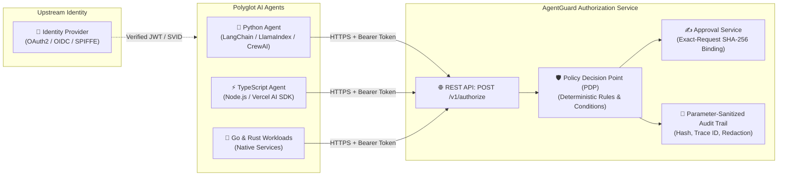

# AgentGuard

**Tool-level authorization, request-bound approvals, and sanitized audit trails for AI agents.**


[](https://central.sonatype.com/artifact/io.github.amaljeevs/agentguard-parent)
[](https://github.com/Amaljeevs/agentguard/releases)
[](https://github.com/Amaljeevs/agentguard/actions/workflows/ci.yml)
[](https://github.com/Amaljeevs/agentguard/actions/workflows/codeql.yml)
[](https://javadoc.io/doc/io.github.amaljeevs/agentguard-parent)
[](https://openjdk.org/projects/jdk/21/)
[](LICENSE)

**Current release: 0.2.1** (Published on Maven Central | 1.0.0 planned stable release)

See [CHANGELOG.md](CHANGELOG.md) for behavior changes and 1.0.0 production stability guarantees.

---

### Understand AgentGuard in 30 Seconds

```text
Identity Provider (OAuth2 / OIDC / mTLS / SPIFFE)
                  │
                  ▼
          Verified Identity (sub, roles, scopes, tenant, delegation)
                  │
  [Model Intent] (Agent proposes tool call & parameters)
                  │
                  ▼
       AgentGuard Decision Point (Deterministic Policy Engine)
                  │
     ┌────────────┼────────────┐
     ▼            ▼            ▼
   ALLOW         DENY   APPROVAL_REQUIRED
     │            │            │
     │            ▼            ▼
     │       Fail-Closed  Human Sign-off (Bound to exact canonical arguments)
     │                         │
     └────────────┬────────────┘
                  ▼
   Guarded Tool / API Execution (Application Authority)
                  │
                  ▼
        Sanitized Audit Trail (Redacted secrets, hashes, trace IDs)
```

#### What AgentGuard Does
* **Prevents tool execution** when deterministic authorization denies it (fail-closed, deny-by-default).
* **Binds human approval to an exact request** using canonical SHA-256 argument fingerprinting (`ApprovalTicket`).
* **Detects modification of approved requests**, preventing parameter tampering between review and execution.
* **Enforces delegation constraints** ensuring child authority is a strict subset of parent authority (`child ⊆ parent`), detecting cycles, enforcing max depth, and isolating tenants.
* **Generates sanitized audit evidence** with policy revision hashes, correlation IDs, and automated secret redaction.
* **Complements upstream security** by integrating with OAuth2, OIDC, Spring Security, Microsoft Entra ID, Keycloak, and SPIFFE.

#### What AgentGuard Does NOT Do
* **Does NOT defeat or detect prompt injection**: AgentGuard does not inspect or classify prompt text or LLM outputs.
* **Does NOT provide complete AI security or sandboxing**: It is an authorization and governance library, not an OS sandbox or container runtime.
* **Does NOT replace authentication**: Upstream identity providers must validate credentials and issue verified claims before AgentGuard evaluates policies.
* **Does NOT claim universal non-bypassability**: Unproxied methods or unguarded tool registrations can bypass enforcement; always register guarded callbacks.

> [!IMPORTANT]
> **Model Intent vs. Application Authority**: An LLM or autonomous agent proposes tool calls and parameters (untrusted *model intent*). The host application, backed by trusted identity and AgentGuard, evaluates and enforces permissions (trusted *application authority*). Safety rules are deterministic code invariants—never prompt-engineered suggestions.

---

## Quickstart: Integrate AgentGuard

### 1. Maven Dependencies

AgentGuard is modular. For a standard Spring Boot 3 application, you only need **`agentguard-spring-boot-starter`**:

```xml
<dependency>
    <groupId>io.github.amaljeevs</groupId>
    <artifactId>agentguard-spring-boot-starter</artifactId>
    <version>0.2.1</version>
</dependency>
```

> [!NOTE]
> `agentguard-spring-boot-starter` automatically brings in the core engine (`agentguard-core`), policy loader (`agentguard-policy`), audit sanitizer (`agentguard-audit`), and `@AgentAuthorize` annotations (`agentguard-spring`).
>
> **Do not add `agentguard-parent` directly as a `<dependency>`**; it has `<packaging>pom</packaging>` and produces no JAR file. If you wish to manage versions centrally, import `agentguard-parent` inside `<dependencyManagement>` as a BOM (Bill of Materials):
> ```xml
> <dependencyManagement>
>     <dependencies>
>         <dependency>
>             <groupId>io.github.amaljeevs</groupId>
>             <artifactId>agentguard-parent</artifactId>
>             <version>0.2.1</version>
>             <type>pom</type>
>             <scope>import</scope>
>         </dependency>
>     </dependencies>
> </dependencyManagement>
> ```

#### Optional Feature Modules
Add only the components your application requires:

| Feature | Dependency | What it provides |
| :--- | :--- | :--- |
| **Human Approvals** | `agentguard-approval` | `ApprovalService`, tickets, SHA-256 argument binding, `PostgresApprovalStore` |
| **Spring AI & MCP Tools** | `agentguard-spring-ai` | `GuardedToolCallback` wrapper for pre-execution Model Context Protocol enforcement |
| **Polyglot REST API** | `agentguard-spring-web` | Auto-configured `POST /v1/authorize` controller for non-Java clients (Python, Node.js) |

---

### 2. Configure Declarative Policy

Create `src/main/resources/agentguard-policy.yaml`:

```yaml
version: "1.0"
metadata:
  name: fintech-payments-governance
  version: "2026-10"

roles:
  payment-agent:
    permissions:
      - payments.transfer
      - payments.read

rules:
  - id: production-high-value-transfer-review
    effect: APPROVAL_REQUIRED
    risk: HIGH
    target:
      actions:
        - payments.transfer
      conditions:
        environment:
          equals: production
```

---

### 3. Protect Methods with `@AgentAuthorize`

Configure authentication through Spring Security or supply a trusted `AgentIdentityResolver`. Never accept identity or roles directly from untrusted model arguments.

```java
@Service
public class TreasuryTransferService {

    @AgentAuthorize(
        action = "payments.transfer",
        resourceType = "account",
        resource = "#fromAccount",
        environment = "production"
    )
    public PaymentReceipt transferFunds(String fromAccount, String toAccount, BigDecimal amount) {
        // Core banking ledger operation, executed only after AgentGuard authorizes it.
        return ledger.executeTransfer(fromAccount, toAccount, amount);
    }
}
```

A matching production approval rule blocks the method by throwing `AgentApprovalRequiredException`. Use the optional `agentguard-approval` module for ticket creation, approver checks, and cryptographic argument binding. Calls must go through the Spring proxy; self-invocation is not intercepted. Use `GuardedToolCallback` for Spring AI and MCP tools.

---

### 4. Configuration Properties

```yaml
agentguard:
  policy-location: classpath:agentguard-policy.yaml
  audit:
    enabled: true
    mask-token: "[REDACTED]"
    sensitive-keys: [routingNumber, accountSecret, iban, taxId, clientSecret]
    failure-mode: FAIL_CLOSED
```

The default JSON audit logger is `io.agentguard.audit.json`. It records a SHA-256 arguments fingerprint, delegation chain, policy version/hash, risk and trace ID; it never emits raw arguments. Authorization and execution outcomes are separate, correlated events. `BEST_EFFORT` is available when continuing after an audit sink failure is an explicit application decision. Post-execution logging failure may occur after side effects; applications still need idempotency.

## Modules

| Module | Responsibility |
| --- | --- |
| `agentguard-core` | Pure Java 21 policy engine, identity/request models, permission matching, content revisions, trusted delegation lookup, and metrics/tracing SPI |
| `agentguard-policy` | YAML loading/validation and declarative policy test CLI |
| `agentguard-audit` | Structured sanitization, `@Sensitive`, JSON/SLF4J/composite publishers, execution lifecycle |
| `agentguard-spring` | `@AgentAuthorize`, fail-closed expression resolution, Spring Security identity bridge, Micrometer metrics |
| `agentguard-spring-boot-starter` | Production auto-configuration, configuration properties, metrics/tracing beans |
| `agentguard-mcp` | Authorization-exception to MCP error-object mapping; no implicit transport registration |
| `agentguard-approval` | Exact-request approvals, cryptographic SHA-256 binding, expiration, atomic store SPI, `InMemoryApprovalStore`, and durable `PostgresApprovalStore` |
| `agentguard-spring-ai` | `GuardedToolCallback` and `ToolCallbackProvider` pre-execution enforcement wrappers |
| `agentguard-spring-web` | Language-neutral JSON `POST /v1/authorize` REST controller and auto-configuration |

The starter does not pull in an MCP server or an LLM provider.

## Policy semantics

Identity validity and explicit DENY rules are checked first. An explicit ALLOW or
role/direct permission must grant the action before a matching approval rule can
return APPROVAL_REQUIRED. Otherwise the result is DENY. For delegation, the
request must be eligible for both child and every trusted ancestor. The child's
complete effective permission set must also be a conservative subset of its
parent's authority (`child ⊆ parent`). Unknown parents, inconsistent chains, privilege expansion,
cycles, excessive depth (>16), tenant mismatch, and invalid temporal bounds deny fail-closed.

### Declarative Conditions and Operators

Rules support deterministic conditional evaluation over request `arguments`, `subject` attributes, `resource` tags, `tenant`, `environment`, and trusted `context` metadata.

The operator set is intentionally minimal, closed, and deterministic:

| Operator | Semantics |
| :--- | :--- |
| `equals` | Strict equality for strings, booleans, and normalized numbers (`10` == `10.0`) |
| `notEquals` | Inverse of `equals` |
| `in` | Value is contained within a declared list |
| `notIn` | Value is absent from a declared list |
| `exists` | Attribute or argument exists and is non-null (`true` or `false`) |
| `contains` | Collection contains element, or string contains substring |
| `greaterThan` | Numeric strict inequality (`>`) |
| `greaterThanOrEqual` | Numeric inequality (`>=`) |
| `lessThan` | Numeric strict inequality (`<`) |
| `lessThanOrEqual` | Numeric inequality (`<=`) |

```yaml
rules:
  - id: high-value-transfer
    effect: APPROVAL_REQUIRED
    risk: HIGH
    target:
      actions:
        - payments.transfer
    conditions:
      arguments:
        amount:
          greaterThan: 50000
      environment:
        equals: production
      subject:
        attributes:
          department:
            equals: treasury
```

### Deterministic Invariants
- **DENY Precedence**: An explicit DENY rule overrides any ALLOW or APPROVAL_REQUIRED.
- **Deny-by-Default**: Unmatched actions, unknown agents, missing permissions, or invalid environments evaluate to DENY.
- **APPROVAL_REQUIRED Restriction**: An approval rule can only gate an action that is otherwise granted by a role or explicit ALLOW rule. It never confers authority by itself.
- **Fail-Closed Evaluation**: Malformed syntax or unknown condition operators fail at policy parse time (`InvalidPolicyException`). Unresolved or missing condition values fail closed at evaluation time.
- **Zero Remote Code Execution (RCE)**: Policies are pure declarative data—no SpEL, Groovy, JavaScript, or arbitrary script execution engines are embedded.

See the [policy specification](specification/docs/POLICY_SPECIFICATION.md) and
[security boundaries](SECURITY.md).

## Architecture and trust flow



```text
OAuth/OIDC, mTLS or SPIFFE verifier
                |
                v
       AgentIdentityResolver  ---- trusted sub/client_id/actor/tenant/scopes
                |
                v
  AuthorizationRequest (identity + action + resource + canonical arguments + context)
                |
                v
     PolicyEngine  ---- DENY / ALLOW / APPROVAL_REQUIRED + policy/risk/trace evidence
          |                                  |
          |                                  v
          |                         ApprovalService (bound SHA-256,
          |                         expiry, atomic single use)
          v                                  |
  guarded method/tool execution <------------+
                |
                v
       sanitized audit evidence
```

`AgentIdentityResolver` is the trust boundary. The built-in JWT claim mapper only
accepts `VerifiedClaims`, which an upstream Keycloak, Entra, Spring Security,
SPIFFE-JWT or custom verifier must produce after validating signature, issuer,
audience and token lifetime. It maps `sub`, `client_id`, `azp`/`appid`, `oid`, `actor`,
`tenant`/`tid`, `scope`/`scp`, Keycloak realm/resource roles (`realm_access`, `resource_access`),
and `delegation_chain`. Dedicated `SpiffeAgentIdentityResolver` resolves workload SVIDs
(`spiffe://<trust-domain>/<workload>`) directly into isolated tenant and agent identities.
Request JSON and model tool arguments never supply effective agent IDs, roles or permissions.

For plain Java use, no server is required:

```java
AgentGuard agentGuard = new AgentGuard(policyEngine, trustedIdentityResolver);
AuthorizationDecision decision = agentGuard.authorize(request);
```

The resolver-backed facade replaces any identity carried by `request` with the
current verified identity. The one-argument constructor remains available for
trusted in-process requests that were already constructed from verified data.

The optional `agentguard-spring-web` module exposes the same engine to other
languages. Applications register `AgentGuardAuthorizationApi` and
`AuthorizationController` with their trusted identity resolver. `principal` is
only checked against that resolved identity; it never grants authority.

```http
POST /v1/authorize
Content-Type: application/json

{
  "principal": "deploy-agent",
  "action": "kubernetes.deploy",
  "resource": {"type": "cluster", "id": "prod-a", "tags": {}},
  "arguments": {"image": "orders:v2"},
  "context": {"environment": "production", "traceId": "trace-123"}
}
```

```json
{
  "decision": "APPROVAL_REQUIRED",
  "reason": "Production deployment requires review",
  "matchedPolicy": "cluster-governance",
  "matchedRule": "prod-deploy-review",
  "policyVersion": "2026-10",
  "policyHash": "...",
  "risk": "CRITICAL",
  "approvalRequestId": "...",
  "traceId": "trace-123"
}
```

Spring AI callbacks can route approval-required calls directly into the approval
module by using the `GuardedToolCallback` constructor that accepts an
`ApprovalService` and TTL. The real callback stays blocked; its exception carries
the bound approval request ID. MCP remains a small error adapter and is absent
from the core engine.

## Architecture Examples & Showcases

Ready-to-run examples demonstrating AgentGuard patterns across enterprise domains:

* **[Enterprise Fintech & Banking MCP Server](agentguard-examples/fintech-banking-mcp-server/README.md)**:
  Full-featured Model Context Protocol (MCP) server and multi-channel agent gateway showcasing high-stakes financial operations:
  - **Dedicated `tool` Package**: Clean domain connectors in `io.agentguard.fintech.tool` mapped deterministically to AgentGuard requests.
  - **Multi-Channel Agent Connectivity**: Serves both MCP-native agents (Claude Desktop, Cursor via `/mcp`) and external REST agents/chatbots (Slack, Teams, webhooks via `/api/agent/channel/invoke`) through the exact same governance rules.
  - **Payments & Wire Transfers**: Domestic & cross-border transfers with amount threshold governance. Canonical SHA-256 argument hashing detects parameter modification and prevents argument tampering between review and execution.
  - **B2B Corporate Disbursements**: Batch payroll and vendor payouts with cryptographic delegation chains (`CFO -> Payroll Bot`) and dual executive signoff.
  - **Escrow Contracts & Dispute Freeze**: Milestone-based fund releases with fail-closed state invariants that block automated releases when contracts are flagged as disputed.
  - **API Management via LLMs**: Denies unauthorized wildcard or root API scopes (`*`), requiring security review for production credentials.
  - **Virtual Accounts & KYC Tiers**: Tier-based issuance limits (automated for Tier 1; human compliance review for high-volume Tier 3).
* **[Spring AI MCP Server](agentguard-examples/spring-ai-mcp-server/README.md)**: Real streamable HTTP MCP server integrating Spring AI tools with AgentGuard authorization, audit redaction, and approval lifecycle. Compatible with Spring AI 1.1.x and modern tool execution lifecycles.
* **[Cross-Language Clients (Python & TypeScript)](agentguard-examples/cross-language-client/README.md)**: Non-Java clients consuming `POST /v1/authorize` with upstream identity injection.

## Using AgentGuard from other languages

While AgentGuard is natively implemented in Java 21, non-Java AI agents (Python, TypeScript/Node.js, Go, Rust) consume the authorization engine as a standalone, language-neutral decision service via the REST API exposed by `agentguard-spring-web`.



### Key Integration Principles

1. **Model Intent vs. Application Authority**: Untrusted AI agents and LLMs must never invent or supply their own effective identity, roles, or scopes. Effective identity is supplied by trusted authentication middleware (e.g. verified Bearer JWT, mTLS, SPIFFE SVID) extracted at the transport boundary.
2. **Deterministic Governance**: Client applications submit the proposed action, target resource, raw arguments, and environment context. AgentGuard returns `ALLOW`, `DENY`, or `APPROVAL_REQUIRED`.
3. **Fail-Closed Execution**: Tools and downstream APIs must only execute when AgentGuard returns an affirmative `ALLOW`.
4. **Human-in-the-Loop Resumption**: When `APPROVAL_REQUIRED` is returned, execution halts. Human reviewers approve the request-bound ticket via the approval API; the agent may only proceed once an approved ticket is presented and atomically consumed.

### Request & Response Schema

```http
POST /v1/authorize
Content-Type: application/json
Authorization: Bearer <VERIFIED_JWT_OR_SPIFFE_TOKEN>
```

```json
{
  "action": "kubernetes.deploy",
  "resource": {
    "type": "cluster",
    "id": "prod-east",
    "tags": { "env": "production" }
  },
  "arguments": {
    "image": "payments-api:v2.4",
    "replicas": 3
  },
  "context": {
    "environment": "production"
  }
}
```

```json
{
  "decision": "APPROVAL_REQUIRED",
  "reason": "Production deployments require DevOps lead sign-off",
  "matchedPolicy": "cloud-infrastructure",
  "matchedRule": "prod-deploy-gate",
  "policyVersion": "2026-10",
  "policyHash": "e2b895e0e0a0...",
  "risk": "HIGH",
  "approvalRequestId": "ticket-7f3b89a1-...",
  "traceId": "trace-9843-abcd"
}
```

### 🐍 Python Example

A minimal, dependency-free Python client using the standard library:

```python
import json
import os
import urllib.error
import urllib.request
from typing import Any, Dict

AGENTGUARD_URL = os.getenv("AGENTGUARD_URL", "http://localhost:8080/v1/authorize")
AUTH_TOKEN = os.getenv("AUTH_TOKEN", "Bearer <VERIFIED_TOKEN_FROM_IDP>")


def authorize_action(
    action: str,
    resource_type: str,
    resource_id: str,
    arguments: Dict[str, Any],
    environment: str = "production",
) -> Dict[str, Any]:
    """Submits a tool authorization request to AgentGuard."""
    payload = {
        "action": action,
        "resource": {"type": resource_type, "id": resource_id, "tags": {"env": environment}},
        "arguments": arguments,
        "context": {"environment": environment},
    }

    req = urllib.request.Request(
        AGENTGUARD_URL,
        data=json.dumps(payload).encode("utf-8"),
        headers={
            "Content-Type": "application/json",
            "Authorization": AUTH_TOKEN,
            "User-Agent": "AgentGuard-Python-Client/1.0.0",
        },
        method="POST",
    )

    try:
        with urllib.request.urlopen(req, timeout=5) as response:
            return json.loads(response.read().decode("utf-8"))
    except urllib.error.HTTPError as exc:
        error_body = exc.read().decode("utf-8")
        if exc.code == 403:
            return json.loads(error_body)
        raise RuntimeError(f"AgentGuard error ({exc.code}): {error_body}") from exc


# Usage in an Agent tool dispatcher
decision = authorize_action(
    action="kubernetes.deploy",
    resource_type="cluster",
    resource_id="prod-east",
    arguments={"image": "payments-api:v2.4", "replicas": 3},
    environment="production",
)

if decision["decision"] == "ALLOW":
    print(f"✓ Authorized by policy {decision.get('matchedPolicy')}. Executing tool...")
    # Safe to execute tool
elif decision["decision"] == "APPROVAL_REQUIRED":
    approval_id = decision.get("approvalRequestId")
    print(f"! Pausing workflow: Human approval required (Ticket: {approval_id})")
    # Notify approvers via Slack/Webhook, then wait for single-use approval ticket
else:
    raise PermissionError(f"✗ Denied: {decision.get('reason')} (Rule: {decision.get('matchedRule')})")
```

### ⚡ TypeScript / Node.js Example

A clean, strongly-typed TypeScript client:

```typescript
import { z } from "zod"; // optional runtime validator, or native fetch

interface AuthorizationRequest {
  action: string;
  resource: {
    type: string;
    id: string;
    tags?: Record<string, string>;
  };
  arguments: Record<string, unknown>;
  context?: {
    environment?: string;
    metadata?: Record<string, string>;
  };
}

interface AuthorizationResponse {
  decision: "ALLOW" | "DENY" | "APPROVAL_REQUIRED";
  reason: string;
  matchedPolicy?: string;
  matchedRule?: string;
  policyVersion?: string;
  policyHash?: string;
  risk?: "LOW" | "MEDIUM" | "HIGH" | "CRITICAL";
  approvalRequestId?: string | null;
  traceId?: string;
}

const AGENTGUARD_URL = process.env.AGENTGUARD_URL || "http://localhost:8080/v1/authorize";
const AUTH_TOKEN = process.env.AUTH_TOKEN || "Bearer <VERIFIED_TOKEN_FROM_IDP>";

export async function authorizeAction(request: AuthorizationRequest): Promise<AuthorizationResponse> {
  const response = await fetch(AGENTGUARD_URL, {
    method: "POST",
    headers: {
      "Content-Type": "application/json",
      "Authorization": AUTH_TOKEN,
      "User-Agent": "AgentGuard-TypeScript-Client/1.0.0"
    },
    body: JSON.stringify(request)
  });

  if (!response.ok && response.status !== 403) {
    const errorBody = await response.text();
    throw new Error(`AgentGuard request failed (HTTP ${response.status}): ${errorBody}`);
  }

  return (await response.json()) as AuthorizationResponse;
}

// Example usage in an autonomous agent runner
async function runGuardedTool() {
  const decision = await authorizeAction({
    action: "kubernetes.deploy",
    resource: { type: "cluster", id: "prod-east", tags: { env: "production" } },
    arguments: { image: "payments-api:v2.4", replicas: 3 },
    context: { environment: "production" }
  });

  switch (decision.decision) {
    case "ALLOW":
      console.log(`✓ Access granted via ${decision.matchedPolicy}. Executing deployment...`);
      // invoke deployment tool callback
      break;

    case "APPROVAL_REQUIRED":
      console.warn(`! Action paused: Approval required. Request ID: ${decision.approvalRequestId}`);
      // pause agent loop until ticket is approved and consumed
      break;

    case "DENY":
    default:
      throw new Error(`✗ Tool blocked: ${decision.reason} [Rule: ${decision.matchedRule}]`);
  }
}
```

## Durable Approval Store (PostgreSQL)

For clustered and multi-instance deployments, `agentguard-approval` provides `PostgresApprovalStore`, a production-grade durable reference implementation backed by standard JDBC `DataSource`.

### Features and Invariants
- **Atomic Single-Use**: Executes `SELECT ... FOR UPDATE` row-level locking during ticket transitions (`APPROVED -> CONSUMED`), preventing race conditions, concurrent double-execution, or replay attacks across multiple service instances.
- **Real Database Verification**: Integration-tested against real PostgreSQL via Testcontainers (`PostgresApprovalStoreIntegrationTest`), verifying schema migration, 10-thread concurrent consumption races (where exactly 1 consumer succeeds), transactional rollback, and expiration.
- **Canonical Schema**: Full DDL schema and indexes are defined in [`schema-postgresql.sql`](agentguard-approval/src/main/resources/schema-postgresql.sql).

```java
@Bean
public ApprovalStore approvalStore(DataSource dataSource) {
    return new PostgresApprovalStore(dataSource);
}
```

Canonical DDL schema (from [`schema-postgresql.sql`](agentguard-approval/src/main/resources/schema-postgresql.sql)):

```sql
CREATE TABLE IF NOT EXISTS agentguard_approvals (
    id VARCHAR(64) PRIMARY KEY,
    subject_id VARCHAR(128) NOT NULL,
    action VARCHAR(255) NOT NULL,
    resource_type VARCHAR(64) NOT NULL,
    resource_id VARCHAR(128) NOT NULL,
    request_hash VARCHAR(128) NOT NULL,
    arguments_hash VARCHAR(128) NOT NULL,
    policy_revision VARCHAR(128) NOT NULL,
    environment VARCHAR(64) NOT NULL,
    trace_id VARCHAR(128) NOT NULL,
    created_at TIMESTAMP WITH TIME ZONE NOT NULL,
    expires_at TIMESTAMP WITH TIME ZONE NOT NULL,
    state VARCHAR(32) NOT NULL,
    decided_by VARCHAR(128)
);

CREATE INDEX IF NOT EXISTS idx_agentguard_approvals_subject ON agentguard_approvals (subject_id);
CREATE INDEX IF NOT EXISTS idx_agentguard_approvals_state ON agentguard_approvals (state);
CREATE INDEX IF NOT EXISTS idx_agentguard_approvals_expires_at ON agentguard_approvals (expires_at);
```

## Observability

AgentGuard provides first-class metrics and distributed tracing integration while enforcing strict privacy invariants:

### Strict Privacy Guarantee
- **Zero Secret or PII Leakage**: Metric tags never contain agent IDs, raw resources, tool arguments, or tokens.
- **Low-Cardinality Tags Only**: Tag dimensions are restricted to bounded enums:
  - `decision`: `ALLOW`, `DENY`, `APPROVAL_REQUIRED`
  - `risk`: `LOW`, `MEDIUM`, `HIGH`, `CRITICAL`
  - `event`: `created`, `approved`, `denied`, `expired`, `consumed`
  - `error_type`: `access_denied`, `missing_identity`, `principal_mismatch`, `invalid_environment`, `execution_failure`

### Micrometer Metrics
When `micrometer-core` is on the classpath and a `MeterRegistry` bean is available, `MicrometerAgentGuardMetrics` automatically records:
- `agentguard.decisions` (Counter): Total authorization decisions categorized by `decision` and `risk`.
- `agentguard.decision.duration` (Timer): Latency of policy evaluation routines.
- `agentguard.approval.events` (Counter): Total approval lifecycle state changes.
- `agentguard.errors` (Counter): Guard enforcement and evaluation failures.

### OpenTelemetry Tracing
Implement `AgentGuardTracingHook` to link AgentGuard audit trails and decision events directly to your distributed trace context:

```java
@Bean
public AgentGuardTracingHook otelTracingHook() {
    return () -> Optional.ofNullable(io.opentelemetry.api.trace.Span.current().getSpanContext().getTraceId());
}
```

Trace IDs are captured in `AuthorizationDecision.traceId()`, `ApprovalTicket.traceId()`, and all structured `AuditEvent` records.

## Threat model

AgentGuard is designed to stop forged payload identities, default-allow gaps,
delegation privilege expansion, altered or replayed approvals, unreviewed tool
execution and secret exposure through its standard audit publisher. It assumes
the application protects policy files, uses a real token/workload-identity
verifier, resolves resource facts such as production environment from trusted
data, registers only guarded callbacks, and implements atomic approval storage
for clustered deployments.

It does not validate credentials itself, sandbox arbitrary code, detect prompt
injection, make remote side effects exactly once, or sanitize logs outside the
AgentGuard audit pipeline. OAuth/JWT proves who presented a valid credential;
AgentGuard decides whether that verified identity may perform this exact action
on this resource now, and records the decision evidence.

## Tests, policy checks, and benchmarks

```shell
mvn clean verify
mvn -f agentguard-policy/pom.xml org.codehaus.mojo:exec-maven-plugin:3.5.0:java "-Dexec.mainClass=io.agentguard.policy.testing.PolicyTestCli" "-Dexec.args=agentguard-examples/spring-ai-mcp-server/src/main/resources/agentguard-policy.yaml specification/examples/policy-scenarios.json"
```

Run the CLI from the repository root after `mvn install`. It prints decisions,
matched rules, and policy revision; mismatched expectations return a failing
process status. CI also builds both independent published-release examples and
runs the Spring AI MCP network tests.

[The JMH harness](benchmarks/README.md) measures evaluation and sanitization for
specified workloads. Report hardware, JDK and workload with results; microbenchmarks
are not end-to-end latency guarantees.

| Integration | Tested baseline |
| --- | --- |
| Core, audit, policy, approvals | Java 21 |
| Spring starter and published consumer examples | Spring Boot 3.3.4 / 3.4.x |
| Spring AI & MCP integration | Spring Boot 3.4+ / 3.5.7, Spring AI 1.1.0 (compatible with 1.x & 2.x tool callbacks), MCP Java SDK 0.16.0 |

Other versions are not claimed compatible until tested. Current audit/approval
changes are documented breaking behavior changes for consumers of 0.1.0.

## Boundaries and future work

Structured redaction does not detect every secret in arbitrary text or sanitize
all third-party logs. The in-memory approval store is not shared across processes
(use `PostgresApprovalStore` for durable clustered deployments). There
is no built-in risk scoring, universal prompt-injection protection, agent sandbox,
or Python/TypeScript/Go runtime. See [why-agentguard.md](why-agentguard.md) for
implemented capabilities and explicitly future work.

## Maintainer and security reports

Maintained by **Amal jeev s** ([@Amaljeevs](https://github.com/Amaljeevs)).
Contact [amaljeevs3739@gmail.com](mailto:amaljeevs3739@gmail.com).
Report vulnerabilities privately using [SECURITY.md](SECURITY.md).

## Publishing

The group ID is `io.github.amaljeevs`. Publishing is a maintainer release action:
select an unused non-SNAPSHOT release version, run all checks, configure Central
credentials/signing, then use `./mvnw clean deploy -P release` (Windows:
`./mvnw.cmd clean deploy -P release`). Version `0.2.1` is published on Maven Central (current latest release);
version `1.0.0` is the finalized upcoming production-stable release. Subsequent releases must use an incremented version.

To publish through GitHub Actions, run **Publish to Maven Central** on the updated
`main` branch, or publish a release whose tag points to the release-version commit.
Re-running an older failed workflow uses its original commit, which may still
contain a SNAPSHOT version. The workflow intentionally rejects those versions.

Set the `GPG_PRIVATE_KEY` Actions secret to the complete ASCII-armored private
key export, including its BEGIN/END lines. The import step accepts actual line
breaks or literal `\n` sequences and rejects malformed keys without logging
their contents. Never paste private keys into issues or build logs.

CI and publishing use the Maven wrapper pinned to 3.9.9. Use the wrapper for
releases: Maven 3.10 can leave `maven-metadata-local.xml` in the publishing
plugin's staging directory, producing Central's misleading missing-POM error.
A failed publish preserves the bundle as a workflow artifact for inspection.

## License

[Apache License 2.0](LICENSE). Copyright (c) 2026 Amal Jeev S.
