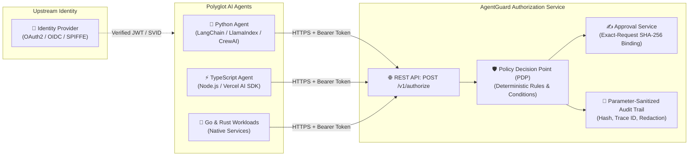

# AgentGuard Cross-Language Client Example

AgentGuard is implemented in native Java 21, but any AI agent environment (Python, TypeScript/Node.js, Go, Rust) can consume the authorization service via the language-neutral REST endpoint:

```http
POST /v1/authorize
```



## Security Invariants

1. **Authentication Complements Authorization**: Transport credentials (e.g. Bearer JWT, mTLS SPIFFE SVID) are verified by the server/middleware. Untrusted LLM agents never supply effective agent identity, roles, or scopes.
2. **Deterministic Evaluation**: AgentGuard validates the proposed action, resource, canonical argument hash, and environment against declarative policies.
3. **Fail-Closed Governance**: Returns `ALLOW`, `DENY`, or `APPROVAL_REQUIRED`.
4. **Tool Execution Boundary**: Applications execute tools only after an affirmative `ALLOW` decision. For `APPROVAL_REQUIRED`, execution pauses until a human signs the request-bound approval ticket.

## Running the Examples

### Python Client

```bash
export AGENTGUARD_ENDPOINT=http://localhost:8080/v1/authorize
export AUTH_TOKEN="Bearer your-jwt-token"

python3 authorize_client.py
```

### TypeScript / Node.js Client

```bash
export AGENTGUARD_ENDPOINT=http://localhost:8080/v1/authorize
export AUTH_TOKEN="Bearer your-jwt-token"

npx ts-node authorize_client.ts
```

## Response Schema

```json
{
  "decision": "ALLOW",
  "reason": "Permitted by rule prod-deploy",
  "matchedPolicyId": "cluster-governance",
  "matchedRuleId": "prod-deploy",
  "policyVersion": "1.0",
  "policyHash": "sha256-...",
  "riskLevel": "MEDIUM",
  "approvalRequestId": null,
  "traceId": "trace-uuid-123"
}
```


