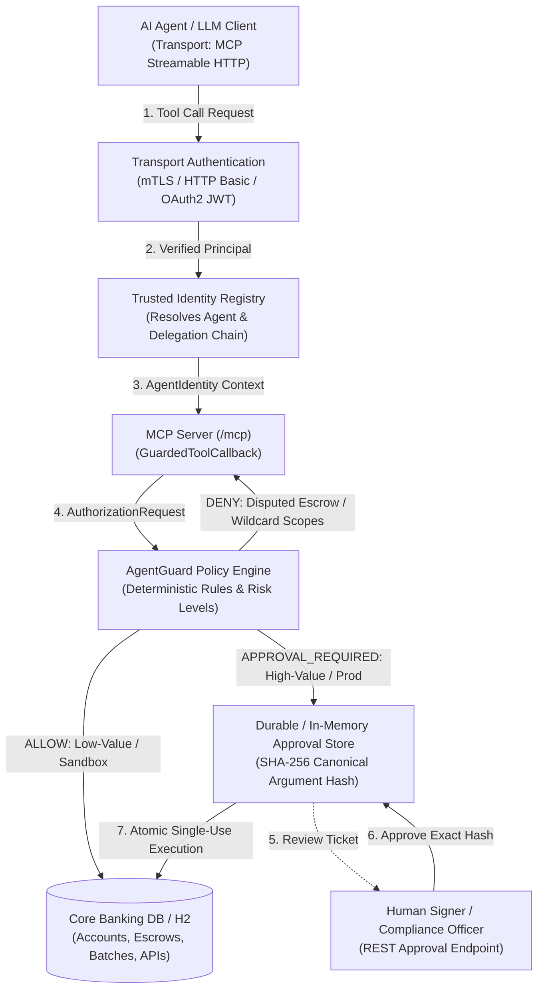

# Enterprise Fintech & Banking MCP Server with AgentGuard

This example demonstrates how **AgentGuard** provides deterministic authorization, cryptographic parameter binding, multi-party approvals, and audit governance for **Model Context Protocol (MCP)** servers in high-stakes financial services and banking environments.

---

## 🏛️ Why AgentGuard for Fintech & Banking?

Autonomous AI agents and LLM tool-calling introduce catastrophic risks in financial systems if connected directly to banking APIs:
* **Prompt Injection & Parameter Tampering**: An attacker or compromised tool output instructs the LLM to modify payment amounts (e.g. from \$100 to \$1,000,000) or alter beneficiary IBANs.
* **Privilege Escalation**: An LLM agent generates wildcard API scopes (`*` or `admin:*`) or bypasses tiered transaction limits.
* **Delegation Provenance Spoofing**: An autonomous payroll bot claims to act on behalf of the CFO without a verified, unexpired delegation chain.
* **State Invariants Bypass**: An automated agent releases escrow funds while a contract is legally disputed or under AML freeze.

**AgentGuard eliminates these risks** by enforcing deterministic, code-level governance that is completely decoupled from model nondeterminism and prompt manipulation.

---

## ⚙️ Architecture & Financial Workflows



---

## 📦 Financial Use Cases Demonstrated

| Category | Tool | Agent Role | Policy & Governance Behavior |
| :--- | :--- | :--- | :--- |
| **Payments** | `transferFunds` | `fintech-bot` | • **Development**: Automatically allowed (`ALLOW`).<br>• **Production**: Requires human authorization (`APPROVAL_REQUIRED`, Risk: HIGH).<br>• **Tampering**: Modifying the amount or recipient post-approval fails cryptographic hash verification. |
| **B2B Disbursements** | `disburseCorporateBatch` | `payroll-bot` (delegated by `corporate-cfo`) | • Verifies cryptographic delegation chain from executive CFO.<br>• Corporate payroll settlements require executive CFO signoff (`APPROVAL_REQUIRED`, Risk: CRITICAL). |
| **Escrow Contracts** | `createEscrow`<br>`releaseEscrow`<br>`disputeEscrow` | `fintech-bot` | • Standard escrow creation allowed.<br>• Flagging an escrow as `DISPUTED` immediately freezes releases.<br>• Attempting release on a disputed escrow is deterministically denied (`DENY`, fail-closed). |
| **API Management** | `createApiClient` | `fintech-bot` | • Creating sandbox read clients is allowed.<br>• Prompt injections requesting wildcard (`*`) or admin scopes are explicitly denied (`DENY`).<br>• Production API clients require Security Officer signoff (`APPROVAL_REQUIRED`). |
| **Virtual Accounts** | `issueVirtualAccount` | `fintech-bot` | • Tier 1 low-limit merchant virtual accounts allowed automatically.<br>• Tier 3 high-volume cross-border virtual accounts require Compliance Officer signoff (`APPROVAL_REQUIRED`). |

---

## 🔒 Cryptographic Defense Against LLM Parameter Tampering

In this example, when a high-value transfer is requested:
1. AgentGuard computes a **SHA-256 canonical hash** of the request parameters (`fromAccount`, `toAccount`, `amount`, `currency`).
2. An `ApprovalTicket` is issued in state `APPROVAL_REQUIRED` and stored.
3. The human compliance officer reviews and approves the ticket.
4. When execution is triggered, AgentGuard re-computes the canonical hash of the submitted payload.
   * If the LLM tampered with the amount (e.g. `$10,000` &rarr; `$100,000`) or changed the destination account, execution is **immediately rejected with 403 Forbidden**.
   * Replay attacks are blocked because the ticket transitions to `CONSUMED` atomically upon first execution.

---

## 🚀 Running and Testing

### Prerequisites
* Java 21+
* Maven 3.9+

### Run Integration Tests
```bash
mvn -f agentguard-examples/fintech-banking-mcp-server/pom.xml clean verify
```

The test suite (`FintechBankingMcpTest`) executes 10 comprehensive end-to-end scenarios covering:
1. MCP tool discovery over streamable HTTP transport (`/mcp`).
2. Automatic execution of development-tier payments.
3. Interception of production payments requiring human approval.
4. Defense against LLM parameter tampering and replay attacks using canonical argument hashing.
5. B2B corporate payroll disbursement with CFO delegation chain verification.
6. Fail-closed dispute holds preventing escrow contract release.
7. Explicit denial of wildcard/admin API scopes generated by prompt injection.
8. Regulatory KYC tiering for virtual account issuance.
9. Rejection of unauthenticated transport calls (401 Unauthorized).
10. Automatic audit sanitization masking sensitive account and routing parameters.

---

## 🛠️ Configuration & Policy Files

* [`agentguard-policy.yaml`](src/main/resources/agentguard-policy.yaml): Declarative financial rules, roles, conditions, and risk thresholds.
* [`schema.sql`](src/main/resources/schema.sql) & [`data.sql`](src/main/resources/data.sql): Database tables and test seed accounts.
* [`FintechBankingTools.java`](src/main/java/io/agentguard/fintech/service/FintechBankingTools.java): Financial operations and request mapping.
* [`FintechMcpConfiguration.java`](src/main/java/io/agentguard/fintech/config/FintechMcpConfiguration.java): Model Context Protocol server configuration with `GuardedToolCallback`.
* [`FintechApprovalsController.java`](src/main/java/io/agentguard/fintech/controller/FintechApprovalsController.java): REST API for human-in-the-loop approvals.
