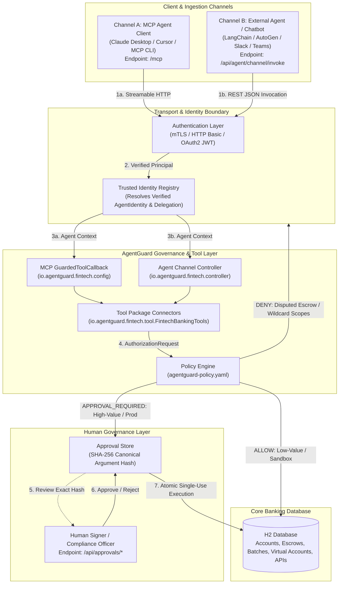

# Enterprise Fintech & Banking MCP Server with AgentGuard

This example demonstrates how **AgentGuard** provides deterministic authorization, cryptographic parameter binding, multi-party approvals, and audit governance for **Model Context Protocol (MCP)** servers and **Multi-Channel Agent Integrations** in high-stakes financial services and banking environments.

---

## 🏛️ Why AgentGuard for Fintech & Banking?

Autonomous AI agents and LLM tool-calling introduce catastrophic risks in financial systems if connected directly to banking APIs:
* **Prompt Injection & Parameter Tampering**: An attacker or compromised tool output instructs the LLM to modify payment amounts (e.g. from \$100 to \$1,000,000) or alter beneficiary IBANs.
* **Privilege Escalation**: An LLM agent generates wildcard API scopes (`*` or `admin:*`) or bypasses tiered transaction limits.
* **Delegation Provenance Spoofing**: An autonomous payroll bot claims to act on behalf of the CFO without a verified, unexpired delegation chain.
* **State Invariants Bypass**: An automated agent releases escrow funds while a contract is legally disputed or under AML freeze.

**AgentGuard eliminates these risks** by enforcing deterministic, code-level governance that is completely decoupled from model nondeterminism and prompt manipulation.

---

## ⚙️ Architecture: Multi-Channel Agent Connectivity

Financial institutions operate across multiple client channels simultaneously. This example shows how **MCP clients** and **external agents/chatbots** share the exact same tool definitions, security policies, and approval workflows:



---

## 📁 Package & Codebase Structure

The example codebase is organized into clean, dedicated packages:

```
io.agentguard.fintech
├── config/
│   ├── FintechMcpConfiguration.java        # Streamable HTTP MCP server (/mcp) registering GuardedToolCallback
│   └── FintechSecurityConfiguration.java   # Stateless HTTP Basic security & CSRF exclusions for /mcp and /api/**
├── controller/
│   ├── FintechAgentChannelController.java  # Multi-channel agent connectivity (/api/agent/channel/invoke & /api/agent/tools)
│   └── FintechApprovalsController.java     # Human approval inspection, approval, rejection, and execution API
├── tool/
│   └── FintechBankingTools.java            # Dedicated tool package containing all banking operations & request mappings
└── service/
    └── TrustedAgentIdentityRegistry.java   # AgentIdentityLookup resolving verified identities & delegation chains
```

---

## 📦 Financial Use Cases Demonstrated

| Category | Tool (in `tool` package) | Agent Role | Policy & Governance Behavior |
| :--- | :--- | :--- | :--- |
| **Payments** | `transferFunds` | `fintech-bot` | • **Development**: Automatically allowed (`ALLOW`).<br>• **Production**: Requires human authorization (`APPROVAL_REQUIRED`, Risk: HIGH).<br>• **Tampering**: Modifying the amount or recipient post-approval fails cryptographic hash verification. |
| **B2B Disbursements** | `disburseCorporateBatch` | `payroll-bot` (delegated by `corporate-cfo`) | • Verifies cryptographic delegation chain from executive CFO.<br>• Corporate payroll settlements require executive CFO signoff (`APPROVAL_REQUIRED`, Risk: CRITICAL). |
| **Escrow Contracts** | `createEscrow`<br>`releaseEscrow`<br>`disputeEscrow` | `fintech-bot` | • Standard escrow creation allowed.<br>• Flagging an escrow as `DISPUTED` immediately freezes releases.<br>• Attempting release on a disputed escrow is deterministically denied (`DENY`, fail-closed). |
| **API Management** | `createApiClient` | `fintech-bot` | • Creating sandbox read clients is allowed.<br>• Prompt injections requesting wildcard (`*`) or admin scopes are explicitly denied (`DENY`).<br>• Production API clients require Security Officer signoff (`APPROVAL_REQUIRED`). |
| **Virtual Accounts** | `issueVirtualAccount` | `fintech-bot` | • Tier 1 low-limit merchant virtual accounts allowed automatically.<br>• Tier 3 high-volume cross-border virtual accounts require Compliance Officer signoff (`APPROVAL_REQUIRED`). |

---

## 🔒 Cryptographic Defense Against LLM Parameter Tampering

In this example, when a high-value transfer is requested:
1. AgentGuard computes a **SHA-256 canonical hash** of the request parameters (`fromAccount`, `toAccount`, `amount`, `currency`).
2. An `ApprovalTicket` is issued in state `APPROVAL_REQUIRED` and stored.
3. The human compliance officer reviews and approves the ticket.
4. When execution is triggered, AgentGuard re-computes the canonical hash of the submitted payload.
   * If the LLM tampered with the amount (e.g. `$10,000` &rarr; `$100,000`) or changed the destination account, execution is **immediately rejected with 403 Forbidden**.
   * Replay attacks are blocked because the ticket transitions to `CONSUMED` atomically upon first execution.

---

## 🚀 Running and Testing

### Prerequisites
* Java 21+
* Maven 3.9+

### Run Integration Tests
```bash
mvn -f agentguard-examples/fintech-banking-mcp-server/pom.xml clean verify
```

The test suite (`FintechBankingMcpTest`) executes 14 comprehensive end-to-end scenarios covering:
1. **MCP Discovery**: Lists all 7 banking tools over streamable HTTP transport (`/mcp`).
2. **Auto-Allowed Payments**: Verifies low-value development payments execute and update accounts.
3. **Production Payments**: Intercepts high-value production transfers with `APPROVAL_REQUIRED`.
4. **Parameter Tampering Prevention**: Validates that modifying payment amounts after approval is rejected via canonical argument hashing.
5. **Replay Attack Defense**: Validates single-use consumption semantics.
6. **B2B Delegation Provenance**: Verifies `payroll-bot` acting on behalf of `corporate-cfo` requires dual executive signoff.
7. **Escrow Dispute Freeze**: Verifies fail-closed denial of releases on disputed escrow agreements.
8. **Prompt-Injected API Wildcards**: Verifies explicit denial when an agent attempts to create wildcard (`*`) scopes.
9. **Production API Governance**: Verifies high-privilege API clients require security officer signoff.
10. **KYC Tiering**: Verifies Tier 1 virtual accounts are automated while Tier 3 accounts require compliance approval.
11. **Multi-Channel REST Tool Discovery**: Verifies external agents can discover tools via `GET /api/agent/tools`.
12. **Multi-Channel REST Tool Execution**: Verifies Slack/chatbot tool invocations execute safely via `POST /api/agent/channel/invoke`.
13. **Multi-Channel REST Approval Halts**: Verifies webhook invocations halt with `APPROVAL_REQUIRED` and return ticket IDs.
14. **Audit Sanitization**: Confirms sensitive account secrets and tokens are redacted with `[REDACTED]`.

---

## 🛠️ Configuration & Policy Files

* [`agentguard-policy.yaml`](src/main/resources/agentguard-policy.yaml): Declarative financial rules, roles, conditions, and risk thresholds.
* [`schema.sql`](src/main/resources/schema.sql) & [`data.sql`](src/main/resources/data.sql): Database tables and test seed accounts.
* [`FintechBankingTools.java`](src/main/java/io/agentguard/fintech/tool/FintechBankingTools.java): Financial operations in dedicated `tool` package.
* [`FintechMcpConfiguration.java`](src/main/java/io/agentguard/fintech/config/FintechMcpConfiguration.java): Model Context Protocol server configuration with `GuardedToolCallback`.
* [`FintechAgentChannelController.java`](src/main/java/io/agentguard/fintech/controller/FintechAgentChannelController.java): REST channel gateway for non-MCP agents and chat platforms.
* [`FintechApprovalsController.java`](src/main/java/io/agentguard/fintech/controller/FintechApprovalsController.java): REST API for human-in-the-loop approvals.
